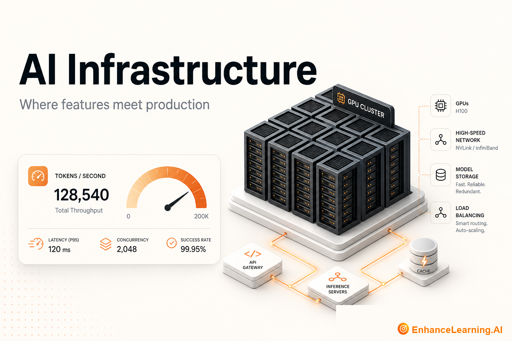

  

# AI Infrastructure: The Layer Where Features Survive Contact With Production

> Maintained reading path from [EnhanceLearning.AI](https://enhancelearning.ai) — practitioner-grade articles for engineers, architects, and technology leaders building production AI-native systems.

**Topic on the site:** [AI Infrastructure](https://enhancelearning.ai/articles?category=AI+Infrastructure) · **Full library:** [enhancelearning.ai/articles](https://enhancelearning.ai/articles)

## What this repo is

A curated reading path for **AI Infrastructure**. It is not a code SDK — it points to the foundation deep-dives on [EnhanceLearning.AI](https://enhancelearning.ai) so you can align on concepts, critique designs, and ship production systems that hold up.

This topic covers what AI infrastructure includes, inference stacks, horizontal vs vertical GPU scaling, token-level observability, and why infrastructure — not just models — determines production outcomes.

## Who it's for

Platform, MLOps, and infrastructure engineers supporting AI workloads.

## Foundation articles

- [What AI Infrastructure Includes in an AI-Native Stack](https://enhancelearning.ai/articles/what-ai-infrastructure-includes-in-ai-native-stack) — AI infrastructure spans gateways, compute, caching, scaling, and API management — not just model weights. See where each layer sits in an AI-native stack.
- [The AI Inference Stack Explained](https://enhancelearning.ai/articles/the-ai-inference-stack-explained) — A clear map of the AI inference stack: gateways, model serving, caching, embeddings, queues, and observability — and what to own versus buy at each layer.
- [Inference Infrastructure is Where AI Features Survive Production](https://enhancelearning.ai/articles/inference-infrastructure-is-where-ai-features-survive-production) — Reliability, latency, and cost are decided at the inference layer — not by prompts or model choice alone. Why the operational foundation matters most.
- [The Architecture of a Production LLM Inference Platform](https://enhancelearning.ai/articles/architecture-of-production-llm-inference-platform) — Production LLM inference as control and data planes: intake, routing, compute scheduling, response delivery, and observability — a platform mental model.
- [Horizontal vs Vertical Scaling for GPU-Backed AI Workloads](https://enhancelearning.ai/articles/horizontal-vs-vertical-scaling-gpu-ai-workloads) — When to add GPU nodes versus upgrade existing ones for LLM inference — tradeoffs across model size, traffic patterns, latency targets, and budget.
- [Why AI Infrastructure Needs Token-Level Observability](https://enhancelearning.ai/articles/why-ai-infrastructure-needs-token-level-observability) — Request counts miss what drives AI cost and latency. Token-level observability — volume, routing, queue metrics — is the day-one baseline for inference infra.

## More from EnhanceLearning.AI

- Homepage: [https://enhancelearning.ai](https://enhancelearning.ai)
- All articles: [https://enhancelearning.ai/articles](https://enhancelearning.ai/articles)
- This topic filter: [AI Infrastructure](https://enhancelearning.ai/articles?category=AI+Infrastructure)
